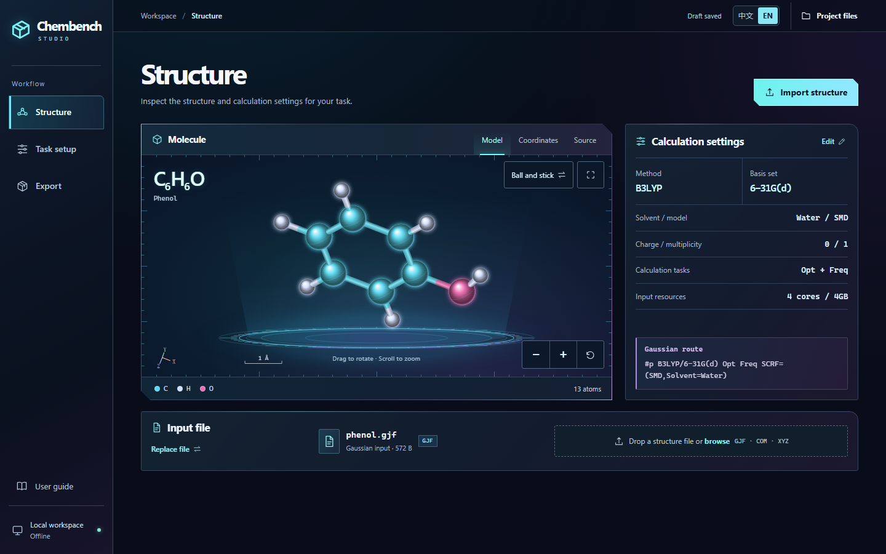
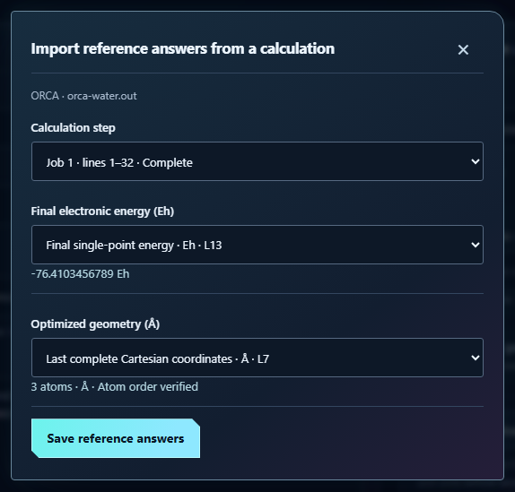

# Chembench Studio

[简体中文](README.zh-CN.md) · [User guide](docs/User-Guide.md) · [Technical manual](docs/Technical-Manual.md)

Chembench Studio is an offline authoring tool for chemistry benchmarks. Start from a molecular structure, define what a solver must submit, and take the reference answers from a Gaussian or ORCA output. The same task can then be exported with the grading conventions of four evaluation frameworks.



## Open the workbench

Download a desktop package from [Releases](https://github.com/Lightmessager/chembench-studio/releases), or open `web/index.html` from a copy of this repository. The workbench runs in a browser with no server, account, or chemistry software installation. Use the language switch to choose English or 简体中文.

| Platform | How to open |
| --- | --- |
| [Windows 10 or 11](https://github.com/Lightmessager/chembench-studio/releases/tag/v1.0.0-windows) | Extract `Chembench-Studio-Windows.zip` and double-click `Chembench Studio.exe`. |
| [macOS](https://github.com/Lightmessager/chembench-studio/releases/tag/v1.0.0-macos) | Extract `Chembench-Studio-macOS.zip` and open `Chembench Studio.app`. If macOS blocks the unsigned launcher, open `Contents/Resources/Studio.html` inside the app bundle. |
| Browser | Download `Chembench-Studio.html` from the release assets and open the saved file in a modern browser. The single HTML file can also be served from a static website. |

## Make your first task

1. **Try the built-in phenol task.** The initial molecule contains 13 atoms. Its heavy-atom count is 7, so a correct submission is `{"value":7}`. Open **Export**, choose a framework, and click a file in the package preview to inspect the prompt or scorer.
2. **Try a task with calculated answers.** Import the [water seed structure](examples/water-seed.xyz). In **Task setup**, import the [energy and geometry rubric](examples/energy-geometry.en.rubric.json), then read the [ORCA example](examples/orca-water.out). Select the final single-point energy and the final Cartesian coordinates, check their units and source lines, and write both to the private answer key. The example output is a synthetic excerpt for testing.
3. **Check the grade.** In the downloadable per-task grading kit, submit just the correct energy. The energy criterion earns 40%, the missing geometry earns zero, and the JSON report shows an overall score of `0.4`. [Step-by-step example](docs/User-Guide.md)



## Inputs and reference answers

| Input | What the author can use |
| --- | --- |
| Gaussian `.gjf` or `.com` | Explicit Cartesian structure, method, basis set, solvent, charge, multiplicity and calculation options. The first step populates the form. The original file retains later Link1 steps and additional input. |
| Single-frame `.xyz` | Coordinates and supported extended-XYZ properties or comment metadata. Fill in missing calculation settings in the workbench. Select a frame before importing a trajectory. |
| Gaussian or ORCA text output | Electronic energies, thermochemical results, signed vibrational frequencies and Cartesian coordinates. Select a normally terminated job. Check geometry convergence and atom order for optimized structures. |

The built-in grading presets compare a scalar with an absolute tolerance, or align two structures and compare the RMSD (default 0.10 Å). A rubric can combine criteria with separate units, tolerances and weights. The author can export the rubric alone or download a Python grading kit with private references. Give the complete task ZIP to the evaluation operator and distribute the prompt, seed and public inputs through the framework. Use **Project files → Save project JSON** for a cross-browser or cross-platform authoring backup. [Output parsing](docs/Calculation-Outputs.md) · [Grading rules](docs/Grading-Rules.md)

## How the frameworks report a score

| Export target | Result for the water example with only the energy correct |
| --- | --- |
| ASI-Bench Chemistry | 40/100 from the custom scorer. |
| MDArena | The energy correctness check passes and the geometry check fails. A separate judge assesses the process. |
| Terminal-Bench-Science | Binary reward 0. The verifier also records a weighted score of 0.4 and the criterion details. |
| Harbor Adapters / Harbor-Index local candidate | Weighted reward 0.4. Official inclusion requires the upstream review process and evaluation runs. |

The exporters adapt task files, submission paths, and reporting to each framework. Full Harbor container runs require the corresponding environment, and MDArena's online process judge requires model credentials. [Framework compatibility and verification](docs/Framework-Compatibility.md) · [Harbor adapter and candidate workflow](docs/Harbor-Adapter.md)

## Extend and build

- **Add a task type.** Import a JSON definition at **Task setup → Import task type**. The [bond-distance example](examples/bond-distance.task-type.json) adds two atom-number fields. The built-in [measurement module](web/measurement.js) demonstrates an automatically computed reference and an independent solver.
- **Add a grading rule.** Use the [scalar](examples/scalar-energy.rubric.json), [geometry](examples/geometry-rmsd.rubric.json), or [mixed rubric](examples/energy-geometry.en.rubric.json) as a starting point. **Rule format for AI** supplies the schema to an AI. The [portable Python scorer](web/rubrics.js) is shared across all four exporters.
- **Build from source.** Use Node.js and Python 3.11+ for tests. On Windows, `--target all` also uses the .NET Framework C# compiler. On macOS or Linux, `python3 tools/build.py --target mac` builds the macOS package and the standalone HTML.

```sh
node --test tests/*.test.cjs
python tools/build.py --target all
node tools/build-grader.cjs
```

For an end-to-end browser check, run `node tools/ui-smoke.cjs release/Chembench-Studio.html`, with `CHROME_BIN` set if needed. [Technical manual](docs/Technical-Manual.md) · [技术手册](docs/技术手册.md)

## License

Chembench Studio is distributed under the [MIT License](LICENSE).
