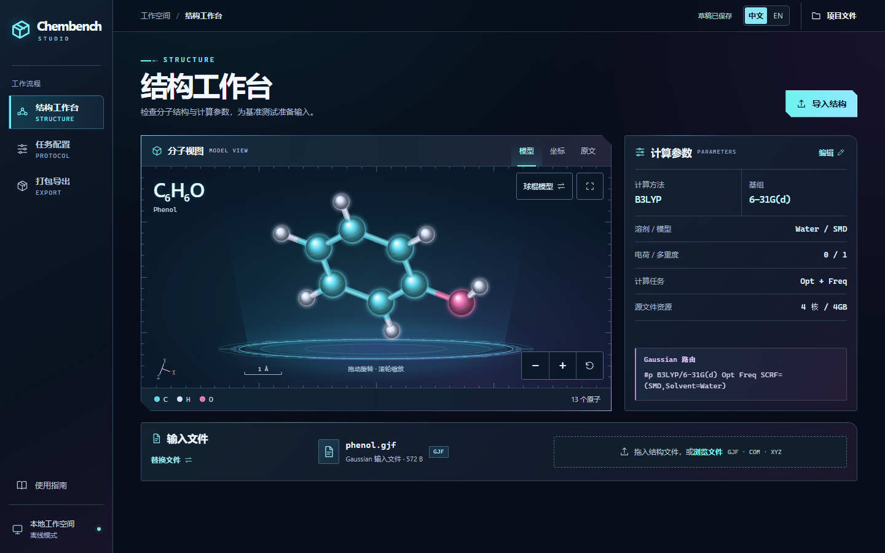
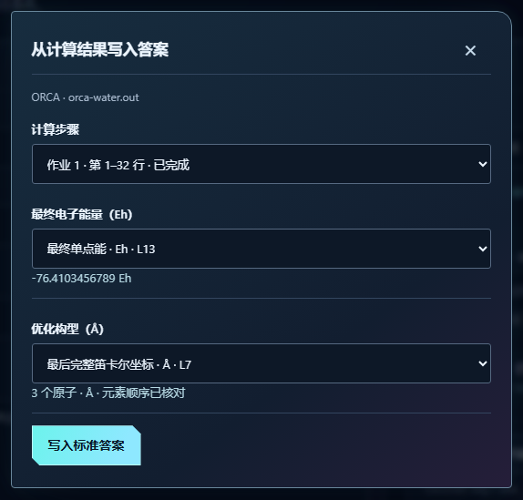

# Chembench Studio

[English](README.md) · [产品介绍与使用指南](docs/产品介绍与使用指南.md) · [技术手册](docs/技术手册.md)

Chembench Studio 是离线化学基准任务编辑器。出题人可以从分子结构编写题面，读取 Gaussian 或 ORCA 输出中的能量、频率和构型作为参考答案，再将同一道题按四种评测框架的规则打包。



## 打开工作台

从[发行页](https://github.com/Lightmessager/chembench-studio/releases)下载对应平台的版本，或在本仓库的本地副本中打开 `web/index.html`。结构解析、题目编辑和任务打包均在浏览器中完成，无需配置服务器、注册账号或安装化学软件。界面中的语言开关可在「简体中文」和「English」之间切换。

| 平台 | 打开方式 |
| --- | --- |
| [Windows 10 或 11](https://github.com/Lightmessager/chembench-studio/releases/tag/v1.0.0-windows) | 解压 `Chembench-Studio-Windows.zip`，双击 `Chembench Studio.exe`。 |
| [macOS](https://github.com/Lightmessager/chembench-studio/releases/tag/v1.0.0-macos) | 解压 `Chembench-Studio-macOS.zip`，双击 `Chembench Studio.app`。若系统限制启动未签名应用，可打开应用包内的 `Contents/Resources/Studio.html`。 |
| 浏览器 | 从发行页下载 `Chembench-Studio.html`，在现代浏览器中打开本地文件。这一份 HTML 也可以直接部署到静态网站。 |

## 做第一道题

1. **用苯酚试跑。** 初次打开时有一个含 13 个原子的苯酚示例。题目要求统计重原子，正确提交为 `{"value":7}`。在「打包导出」中选择目标框架，点目录里的文件名即可预览题面和评分器。
2. **从计算输出写入参考答案。** 导入[水分子初始结构](examples/water-seed.xyz)。在「任务配置」导入[能量与构型联合规则](examples/energy-geometry.rubric.json)，点击「读取计算输出」，选取 [ORCA 示例](examples/orca-water.out)。将能量绑定到「最终单点能」，构型绑定到「最后完整笛卡尔坐标」，核对单位和来源行后点击「写入标准答案」。该输出是用于演示导入流程的人工节选。
3. **检查部分得分。** 点击「下载独立评分包」，只提交正确的能量。能量占 40%，缺交的构型得零，报告中的 `score` 为 `0.4`。[完整算例和批改命令](docs/产品介绍与使用指南.md)



## 可用的输入和参考答案

| 输入 | 支持内容 |
| --- | --- |
| Gaussian `.gjf` 或 `.com` | 从显式笛卡尔坐标与路由读取结构、方法、基组、溶剂、电荷、多重度与计算选项。表单采用第一计算步，原文件保留 Link1 后续步骤及附加输入。 |
| 单帧 `.xyz` | 读取普通 XYZ、支持的扩展 XYZ 属性和注释行参数。缺少的计算条件可手工补填，多帧轨迹需先选定目标帧。 |
| Gaussian 或 ORCA 文本输出 | 读取电子能、热力学量、有符号振动频率及坐标。选择正常结束的作业段。优化结构还需核对收敛记录和原子顺序。 |

两套内置评分预设分别判断数值的绝对误差、构型对齐后的 RMSD（默认容差 0.10 Å）。可用自定义规则组合多项结果，为每项单独设置单位、容差和权重。可分别导出规则和含私有答案的独立评分包。完整任务 ZIP 交给评测维护者，由框架向答题者提供题面、初始结构和公开材料。更换浏览器或电脑时，可通过「项目文件 → 保存项目 JSON」备份当前工作。[计算输出导入说明](docs/results.md) · [评分标准规范](docs/rubrics.md)

## 同一份答卷在四个框架中的成绩

| 导出目标 | 水分子示例只答对能量时的记录 |
| --- | --- |
| ASI-Bench Chemistry | 自定义评分器给 40/100。 |
| MDArena | 能量正确性检查通过，构型项得零。过程评审单列。 |
| Terminal-Bench-Science | 框架上报二值奖励 0，并保留 0.4 的加权分和分项诊断。 |
| Harbor Adapters / Harbor-Index 本地候选 | 加权奖励为 0.4。正式收录需经上游审查并完成相应评测。 |

导出器按各框架要求生成目录、答卷路径和评分报告。运行完整 Harbor 评测需要配置容器环境，运行 MDArena 在线过程评审需要相应的模型凭据。[框架兼容性与验证范围](docs/compatibility.md) · [Harbor 候选集说明](docs/harbor-index.md)

## 扩展与构建

- **新增题型。** 在「任务配置 → 导入类型定义」载入 JSON。[键长题型示例](examples/bond-distance.task-type.json)添加两个公开的原子编号字段。内置[键长测量模块](web/measurement.js)演示如何自动计算参考值和提供独立参考解。
- **新增规则。** 可从[数值规则](examples/scalar-energy.rubric.json)、[构型规则](examples/geometry-rmsd.rubric.json)或[联合规则](examples/energy-geometry.rubric.json)起步。「AI 编写格式」提供可复制的规范，四个导出器共享同一套[纯 Python 判分实现](web/rubrics.js)。
- **从源码构建。** 测试需要 Node.js 和 Python 3.11+。Windows 构建全部发行包还需 .NET Framework C# 编译器。在 macOS 或 Linux 上，可用 `python3 tools/build.py --target mac` 生成 macOS 包与单文件 HTML。

```sh
node --test tests/*.test.cjs
python tools/build.py --target all
node tools/build-grader.cjs
```

运行 `node tools/ui-smoke.cjs release/Chembench-Studio.html` 可验收浏览器流程，`CHROME_BIN` 可指定本机 Chromium 的位置。[中文技术手册](docs/技术手册.md) · [English technical manual](docs/Technical-Manual.md)

## 许可证

Chembench Studio 采用 [MIT 许可证](LICENSE)。
