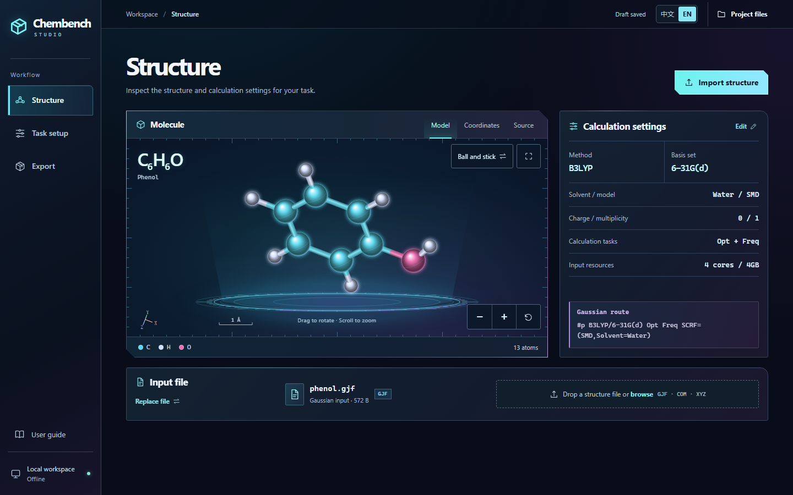
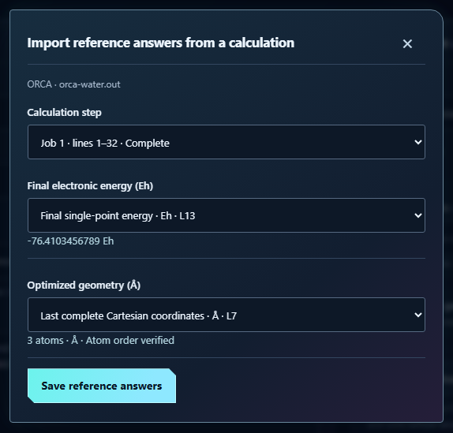

# Chembench Studio User Guide

Chembench Studio turns a molecular structure, calculation settings, and completed calculation outputs into a chemistry benchmark task with a private answer key. In this example, you will prepare a two-part question about water, then test the grader with a deliberately incomplete answer. Use the language switch in the workbench to choose **English** or **简体中文**.

[中文版](产品介绍与使用指南.md) · [Technical manual](Technical-Manual.md)

## Import a structure and write the question

Extract the desktop package. On Windows, open `Chembench Studio.exe`. On macOS, open `Chembench Studio.app`. You can also open the standalone `Chembench-Studio.html` in a browser. Task authoring runs locally. The example files are in the package's `examples` directory.

1. In **Structure**, click **Import structure** and select [water-seed.xyz](../examples/water-seed.xyz). Open the coordinate table and confirm that its three atoms are O, H, H, in that order. This file provides the starting geometry for the solver.
2. Review the calculation settings. Gaussian GJF and COM files can supply the method, basis set and solvent from their route section. Plain XYZ files usually supply coordinates alone. For a real task, enter the conditions actually used to calculate the references.
3. In **Task setup**, choose the multi-result task type. Give the solver this instruction: “Submit the final electronic energy of the optimized structure in Eh and the Cartesian coordinates in Å. Keep the atoms in the order used by the input file.” The example output is a synthetic formatting excerpt for practicing the import workflow.



## Write the reference answers

In the scoring settings, import [energy-geometry.en.rubric.json](../examples/energy-geometry.en.rubric.json) and confirm. This rubric applies both built-in grading methods to the same submission.

| Criterion | Requirement for full credit | Weight |
| --- | --- | --- |
| Final electronic energy | Absolute difference from the reference ≤ 0.0001 Eh | 40% |
| Optimized geometry | RMSD ≤ 0.10 Å after rigid rotation and translation, with atoms matched in input order | 60% |

Click **Read calculation output** and open [orca-water.out](../examples/orca-water.out). In the normally terminated job with a converged optimization, bind the energy to the final single-point energy. It should read −76.4103456789 Eh. Bind the geometry to the last complete Cartesian coordinates and check that it contains three atoms. Check the units, source lines and atom order, then click **Save reference answers**. For Gaussian outputs, the same workflow lets you select an SCF energy, thermochemical quantity or vibrational frequency.

To create a different rubric with an AI, open **Rule format for AI** and give them to the AI along with your question. Import its JSON, then bind the reference values for the new task.



## Grade a trial submission and distribute the task

Click **Download grading kit** and extract the per-task ZIP. In the extracted directory, create `submission.json` containing `{"energy":-76.4103456789}`. With Python 3.11 or later, run the following command in that directory. On macOS you may need to enter `python3` in place of `python`.

```sh
python grade.py submission.json private-reference.json > score.json
```

Open `score.json`. The expected `score` is 0.4 and `passed` is false. The correct energy earns 40%, and the missing geometry earns zero. A complete solver submission includes both fields in the `answer.json` named in the exported task.

Open **Export**, choose a framework, and click any filename to preview it. Export the ZIP. Each framework records the trial submission according to its scoring contract.

| Export target | Result with only the energy correct |
| --- | --- |
| ASI-Bench Chemistry | 40/100 |
| MDArena | The energy correctness check passes and the geometry criterion earns zero. The process judge runs separately. |
| Terminal-Bench-Science | Binary reward 0. The criterion report also records 0.4. |
| Harbor Adapters / Harbor-Index local candidate | Weighted reward 0.4 |

Give the complete task ZIP to the evaluation operator. The framework supplies the solver with the prompt, seed structure and public inputs. The task author keeps the source calculation logs, grading kit and project JSON containing the private answers. To continue editing on another machine, save the project JSON in the project menu and reopen it on the other computer.
