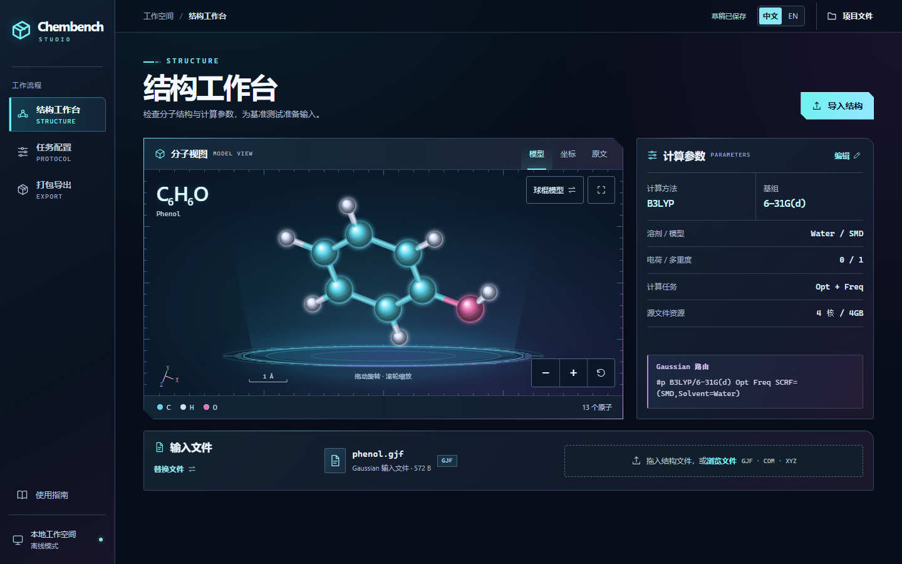

# Chembench Studio 产品介绍与使用指南

Chembench Studio 帮助化学出题人把分子结构、计算条件和已有计算结果制成可评分的测试题。跟着水分子示例，你可以完成一道同时考查能量与构型的题目，再用一份故意漏答的答卷检验评分结果。

[English](User-Guide.md) · [技术手册](技术手册.md)

## 导入结构并写好题面

解压对应的发行包。Windows 双击 `Chembench Studio.exe`，macOS 双击 `Chembench Studio.app`，也可用浏览器直接打开单文件版 `Chembench-Studio.html`。出题过程在本机进行，无需先安装化学计算软件。通过工作台的语言开关可选择「简体中文」或「English」。示例文件位于发行包的 `examples` 目录。

1. 在「结构工作台」点击「导入结构」，选择 `water-seed.xyz`。切换到「坐标」，确认共 3 个原子，顺序为 O、H、H。这份文件提供答题者拿到的初始构型。
2. 核对「计算参数」。GJF 或 COM 可从 Gaussian 路由读出方法、基组、溶剂等信息。普通 XYZ 通常只有坐标。制作正式题时，点击「编辑」，按生成参考答案时实际采用的条件补齐参数。
3. 在「任务配置」选择「综合任务 · 多项结果」。在「给答题者的要求」写明“提交优化后的最终电子能量（Eh）和笛卡尔坐标（Å）。坐标按输入文件的原子顺序排列。”本例的计算输出是用于练习导入的人工格式节选。



## 从计算结果写入标准答案

在「评分依据」点击「导入规则 JSON」，选择 `energy-geometry.rubric.json` 并确认导入。这条规则把两种内置评分方式用在同一份答卷中。

| 评分项 | 通过条件 | 分值占比 |
| --- | --- | --- |
| 最终电子能量 | 与参考值的绝对差 ≤ 0.0001 Eh | 40% |
| 优化构型 | 按原子顺序旋转、平移对齐后，坐标 RMSD ≤ 0.10 Å | 60% |

点击「读取计算输出」，选择 `orca-water.out`。在正常结束且优化收敛的作业段，将能量绑定到「最终单点能」，应看到 −76.4103456789 Eh。将构型绑定到「最后完整笛卡尔坐标」，应看到 3 个原子。核对单位、来源行和原子顺序后，点击「写入标准答案」。使用 Gaussian 输出时，可用同一入口选择所需的 SCF 能量、热力学量或振动频率。

需要为其他任务设计规则时，点击「AI 编写格式」，把其中的说明连同题面交给 AI。将生成的 JSON 从同一入口导入，再绑定这道题自己的参考值。


## 试评答卷并分发任务

点击「下载独立评分包」并解压。为验证两项能否分别得分，在解压目录新建 `submission.json`，写入 `{"energy":-76.4103456789}`。用 Python 3.11 或以上版本在该目录运行以下命令。macOS 可将 `python` 换成 `python3`。

```sh
python grade.py submission.json private-reference.json > score.json
```

打开 `score.json`。预期 `score` 为 0.4，`passed` 为 false。能量项拿到 40%，缺交的构型项得零。正式作答时，两项都写入题面约定的 `answer.json`。

在「打包导出」选框架，点文件名预览后点击「导出 ZIP」。同一份试评答卷在四种目标下的记录如下。

| 导出目标 | 只答对能量时的记录 |
| --- | --- |
| ASI-Bench Chemistry | 40/100 |
| MDArena | 能量正确性检查通过，构型项得零。过程评审另算。 |
| Terminal-Bench-Science | 框架奖励为 0，分项报告保留 0.4 |
| Harbor Adapters / Harbor-Index 本地候选 | 加权奖励为 0.4 |

将完整任务 ZIP 交给评测维护者，由框架向答题者提供题面、初始结构和公开材料。计算日志、独立评分包和含答案的项目 JSON 由出题人保管。换电脑继续编辑时，可通过「项目文件」保存并恢复项目 JSON。
